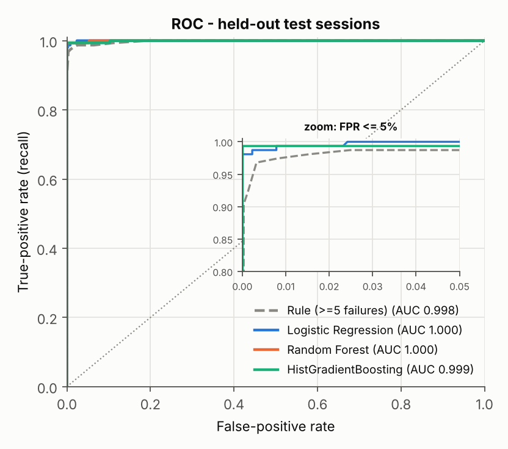
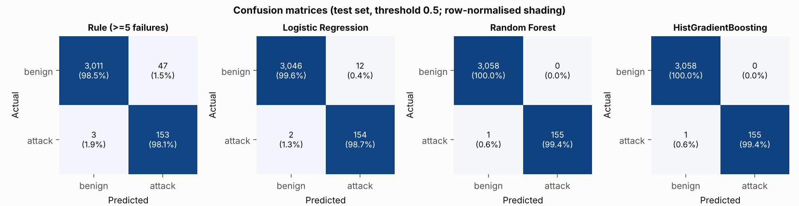
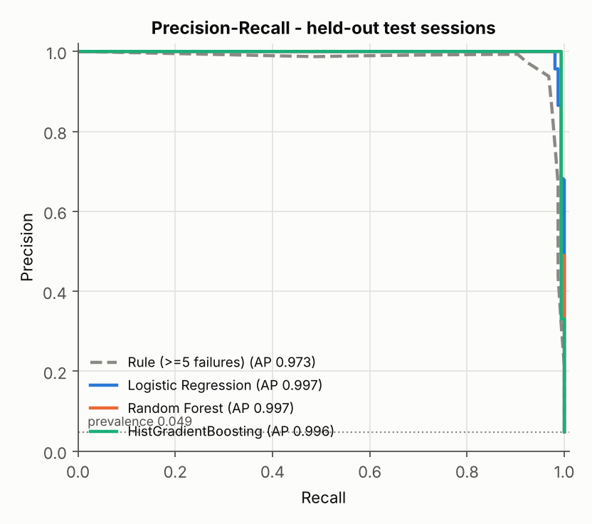
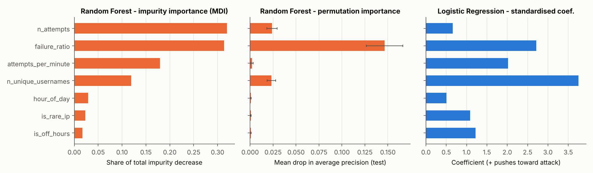
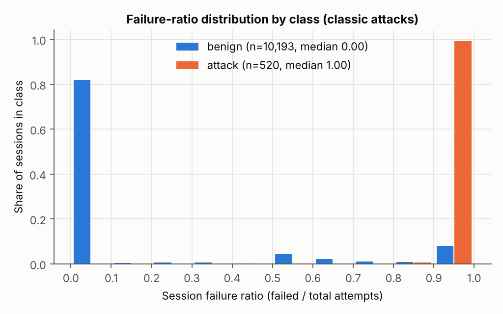
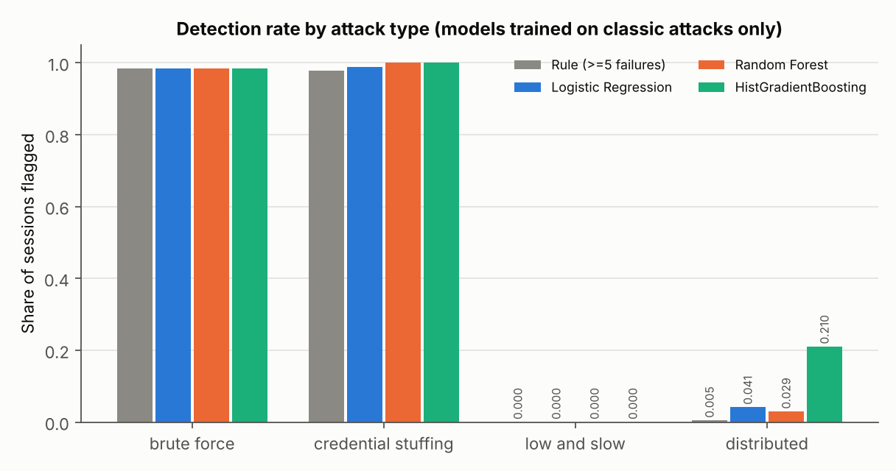
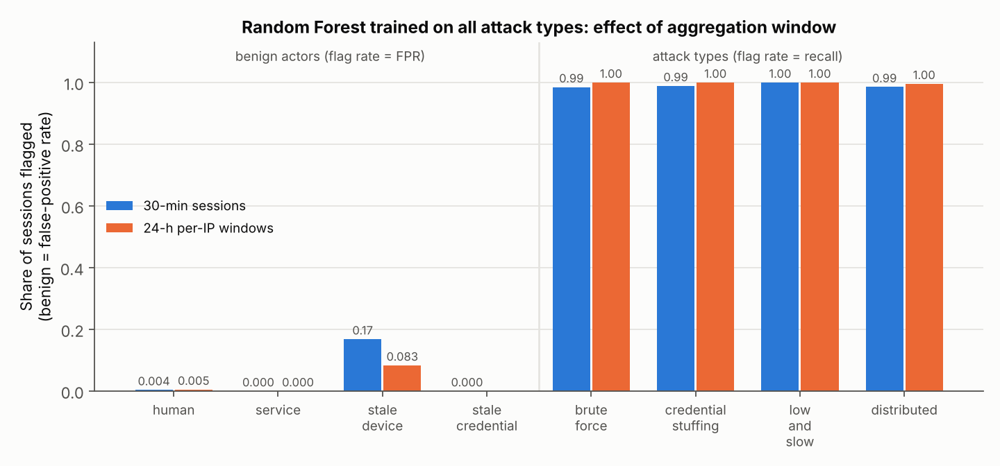

# Detecting Brute-Force and Credential-Stuffing Login Attacks from Authentication-Event Features: Strong In-Distribution Accuracy, Brittle Against Slow and Distributed Adversaries

*Synthetic-data study. All code, data and results are in this repository and can be reproduced with
`python run_pipeline.py` in about 50 seconds.*

---

## Abstract

Online password-guessing attacks remain among the most common ways accounts get compromised. The two main forms are
brute force, which hammers a few accounts, and credential stuffing, which replays leaked username/password pairs across
many accounts. We study how far seven cheap behavioural features get us when we classify per-IP login sessions as
attack or legitimate: attempt count, failure ratio, distinct usernames, attempt rate, hour of day, an off-hours flag,
and an IP-rarity prior. Because labelled authentication logs are scarce, we build a documented simulator of a
600-user organisation over 28 days, producing 82,957 login events and 13,735 evaluation sessions. The simulator
includes realistic benign look-alikes: shared office NAT, carrier-NAT mobile IPs, dynamic home IPs, service accounts,
and devices that keep retrying a stale password.

We compare a fail2ban-style rule (five or more failures), Logistic Regression, Random Forest and
HistGradientBoosting. On held-out sessions containing classic attacks, the tree ensembles reach F1 = 0.997
(precision 1.000, recall 0.994, ROC-AUC ≥ 0.999). Logistic Regression reaches F1 = 0.957 and the rule F1 = 0.860, with
the rule's false-positive rate 1.5 %. These results hold under 5-fold cross-validation and across five independently
generated datasets: Random Forest F1 = 0.987 ± 0.008.

The same models are blind to evasion. They detect **0 %** of low-and-slow sessions (one guess every 35 to 180 min)
and **0.4 to 21 %** of distributed-botnet sessions. Retraining on those attacks restores recall above 0.98, but it
raises the false-positive rate on benign stale-device retries to 16.8 %. Widening the aggregation window from 30
minutes to 24 hours per IP halves that to 8.3 % and lowers the overall FPR from 1.44 % to 0.78 %. In short, simple
session features solve classic online guessing, but the real difficulty lies in how activity is aggregated and in
benign look-alikes, not in the choice of classifier.

---

## 1. Introduction

Authentication endpoints, such as web login forms, VPN portals, SSH, and IMAP/SMTP for mail, are continuously
probed by automated password-guessing tools. Breach corpora containing billions of credential pairs make
*credential stuffing* cheap, and password reuse makes it effective [3, 4]. Thomas et al. found that credentials
leaked in data breaches and phishing are a leading driver of account hijacking [3]. Standards bodies treat online
guessing as a baseline threat: NIST SP 800-63B requires verifiers to rate-limit failed attempts [6], and MITRE
ATT&CK catalogues password guessing, password spraying and credential stuffing as sub-techniques of T1110 [1, 7].

Operationally, most organisations rely on threshold rules such as "block an IP after *N* failures in *T* minutes",
as in fail2ban [13], or on vendor bot-management products. Threshold rules are transparent but blunt. They
fire on benign users who mistype passwords or on misconfigured clients, and adversaries who know the thresholds can
avoid them by staying under them.

This project asks three questions:

1. **RQ1.** How well do a handful of interpretable per-session features separate classic brute-force and
   credential-stuffing sessions from legitimate traffic? Does machine learning beat a threshold rule?
2. **RQ2.** How do models trained on classic attacks behave against *adaptive* adversaries who slow down
   (low-and-slow) or spread out over many IPs (distributed)?
3. **RQ3.** Does changing the aggregation window help, and at what false-positive cost?

**Contributions.** (i) A documented, seedable simulator of login traffic that deliberately includes the benign
behaviours that cause false positives in practice. (ii) A modular scikit-learn pipeline (feature extraction,
four detectors, four experiments) that runs in under one minute on a CPU. (iii) Quantitative evidence that
in-distribution accuracy is close to perfect but says little about robustness, and that aggregation granularity is
the lever that matters.

## 2. Background

### 2.1 Online guessing attacks

* **Brute force / password guessing (T1110.001).** The attacker targets one or a few usernames, often defaults
  such as `admin` or `root`, or harvested employee names, and tries many candidate passwords taken from popular-password
  distributions [5]. The signature is many attempts, few usernames, a high failure ratio, and a high rate.
* **Credential stuffing (T1110.004; OWASP OAT-008 [2, 8]).** The attacker replays leaked `(username, password)` pairs.
  Each pair is typically tried once, so the signature is **many distinct usernames per IP**, most of them
  non-existent at the target, with a near-total failure ratio and a small success rate driven by password reuse [4, 11].
* **Evasive variants.** *Low-and-slow* guessing spaces attempts far apart in time to stay below rate limits and
  inactivity windows. *Distributed* guessing coordinates many source IPs (botnets, residential proxies) so that
  each IP contributes only a few attempts. Javed and Paxson showed that such stealthy distributed SSH brute-forcing
  is invisible to per-host detectors and must be detected by aggregating across sources [9].

### 2.2 Detection approaches

* **Threshold and rate-limit rules**, such as fail2ban [13] and the throttling in NIST 800-63B [6], count failures per IP
  or account within a time window. They are simple and explainable, but they produce false positives on stale credentials
  and can be evaded by staying under the threshold.
* **Flow- and log-based statistical detection.** Hofstede et al. detect web-application brute-force attacks from flow
  records [10]. Javed and Paxson model the aggregate site-wide failure rate to reveal distributed campaigns [9].
* **Risk-based authentication.** Freeman et al. score each login by how unusual its context is for that user (IP,
  ASN, user agent), using a statistical model of past logins [12]. Our `is_rare_ip` feature is a crude, global
  version of this idea.
* **Supervised ML on engineered features**, the approach studied here. Sommer and Paxson [14] and Arp et al. [15]
  warn that ML-based intrusion detection often looks excellent in closed-world evaluations but generalises poorly. Our
  E2 experiment is designed to measure exactly that gap.

## 3. Methodology

### 3.1 Data-generating process

We simulate one organisation over two consecutive 14-day windows starting Monday 2026-01-05
(`src/data_generation.py`; every constant is in `src/config.py`).

* **History window (days 0 to 13): benign traffic only.** It is used for one thing: an IP-reputation table counting the
  successful logins seen from each IP.
* **Evaluation window (days 14 to 27): benign and attack traffic.** Every session we train or test on comes from here.

**Benign actors.**

* *600 employees.*
  * Each has a schedule: 85 % office hours (first login ≈ N(08:30, 1.5 h)), 10 % night shift, 5 % in a +8 h time zone.
  * Activity probability is 0.85 on weekdays and 0.25 at weekends, with 1 + Poisson(0.8) logins per active day.
  * 65 % of employees sit behind one of six shared office NAT IPs, so many usernames appear per IP.
  * Home IPs are re-assigned with probability 0.02 per day.
  * Logins originate from a 2,000-address carrier-NAT mobile pool with probability 0.20, a shared VPN exit with
    probability 0.04, or a never-seen travel IP with probability 0.04.
  * 12 % of logins begin with Geometric(0.55) typos (at most 8), and 15 % of those users give up.
* *Service accounts.* Four accounts authenticate every 10 to 15 min, 24/7, from internal IPs.
* *Hard negatives.*
  * **Stale-device retries:** 4.8 % of users change their password while a second device keeps retrying the old one.
    It produces 1 to 3 failures every 10 to 90 min for 1 to 36 h, 70 % of the time from mobile IPs that hop around the pool.
  * **Stale-credential incidents:** three cases where a service job retries a rotated password every 30 to 60 s for 1 to 6 h.

**Attackers** (evaluation window only; 50 % of campaigns start between 00:00 and 06:00, the rest uniformly).

| Type | Campaigns | Behaviour |
|---|---|---|
| brute_force | 200 | 1 IP; 1 to 5 targets (50 % real employees, 50 % default names); LogNormal(ln 60, 1) attempts clipped to [8, 800]; mean inter-arrival LogUniform[0.5, 20] s; 8 % chance the last guess succeeds |
| credential_stuffing | 200 | 1 + Poisson(0.5) rotating IPs; LogNormal(ln 50, 1) pairs clipped to [6, 600]; 25 % real usernames, 5 % success on those; 10 % of pairs retried; mean inter-arrival LogUniform[1, 30] s |
| low_and_slow (evasive) | 25 | 1 IP; 1 to 3 real targets; 20 to 80 attempts spaced U(35, 180) min apart |
| distributed (evasive) | 6 | credential stuffing with 150 to 600 pairs spread over 2 to 12 h across a botnet of 80 to 250 IPs |

In 15 % of classic campaigns the attacker egresses through a VPN exit that benign users also use, so
`is_rare_ip = 0`. The final log contains **82,957 events**: 21,255 in the history window and 61,702 in the evaluation window.

### 3.2 Sessionisation and features

Events are grouped by source IP. A new session starts after more than 30 min of inactivity, and sessions are cut
into 60-min chunks so that continuously active IPs, such as service accounts, still yield comparable units. For each
session we compute the seven features below (`src/features.py`):

| Feature | Definition |
|---|---|
| `n_attempts` | number of attempts |
| `failure_ratio` | failed / total attempts |
| `n_unique_usernames` | distinct usernames tried |
| `attempts_per_minute` | `n_attempts / max(duration_min, 1)` |
| `hour_of_day` | hour of the first attempt |
| `is_off_hours` | 1 if the first attempt falls between 00:00 and 05:59 |
| `is_rare_ip` | 1 if the IP had fewer than 2 successful logins in the history window |

A session is labelled *attack* if any of its events belongs to an attack campaign. A separate `kind` column records
the ground-truth actor (e.g. `stale_device`) for error analysis only.

**Table 1. Evaluation-window sessions and mean feature values by actor.**

| Actor | Sessions | n_attempts | failure_ratio | n_unique_usernames | attempts/min | off-hours | rare IP |
|---|---:|---:|---:|---:|---:|---:|---:|
| human (benign) | 8,161 | 1.53 | 0.08 | 1.25 | 1.12 | 0.08 | 0.36 |
| service (benign) | 1,335 | 5.05 | 0.00 | 1.00 | 0.11 | 0.25 | 0.00 |
| stale_device (benign) | 688 | 2.53 | 1.00 | 1.00 | 1.66 | 0.23 | 0.47 |
| stale_credential (benign) | 9 | 53.44 | 0.78 | 1.00 | 0.92 | 0.00 | 0.00 |
| brute_force | 207 | 97.27 | 1.00 | 2.00 | 24.90 | 0.70 | 0.87 |
| credential_stuffing | 313 | 53.09 | 0.99 | 49.42 | 9.44 | 0.62 | 0.84 |
| low_and_slow | 1,250 | 1.00 | 1.00 | 1.00 | 1.00 | 0.24 | 1.00 |
| distributed | 1,772 | 1.28 | 0.99 | 1.28 | 0.84 | 0.39 | 1.00 |

Two observations stand out. First, 36 % of human sessions come from a "rare" IP, because of mobile pools, IP churn
and travel, so IP rarity is only weak evidence on its own. Second, the evasive attacks are nearly indistinguishable
from stale-device retries at session granularity: one or two attempts, all failed, often from a rare IP.

### 3.3 Detectors

* **Rule baseline:** flag a session if it contains five or more failures, a fail2ban-style rule. For ROC analysis, the
  failure count serves as its score.
* **Logistic Regression (LR):** `log1p` on the count and rate features, standardisation, L2 penalty, and class-balanced loss.
* **Random Forest (RF):** 300 trees, `min_samples_leaf = 2`, class-balanced bootstrap [16].
* **HistGradientBoosting (HGB):** 200 boosting iterations, learning rate 0.1, class-balanced; a LightGBM-style
  histogram GBDT [18].

All learned models use scikit-learn [17] defaults unless stated otherwise, and all use a fixed 0.5 decision threshold.

### 3.4 Experimental protocol

* **E1, main comparison.** Benign plus classic-attack sessions: 10,713 sessions, of which 520 are attacks (4.9 %).
  We use a stratified 70/30 split (test set: 3,214 sessions, 156 attacks) and also run stratified 5-fold CV.
* **E2, evasion.** The E1 models are applied *without retraining* to all 1,250 low-and-slow and 1,772 distributed
  sessions. We report the share of sessions flagged, and the share of campaigns with at least one flagged session.
* **E3, aggregation window.** An RF is trained on *all* sessions, including the evasive attacks, with the same 70/30
  protocol. Feature extraction uses either (a) the default 30-min/60-min sessions or (b) 24-h per-IP windows
  (gap = cap = 24 h).
* **E4, robustness.** E1 is repeated on five worlds regenerated with seeds 0 to 4.

Metrics are accuracy, precision, recall, F1, ROC-AUC, PR-AUC (average precision), FPR, and the confusion matrix.
Because attacks make up only 4.9 % of sessions, accuracy is dominated by the benign class, so we emphasise precision,
recall, F1, FPR and PR-AUC [19].

## 4. Experiments and Results

All numbers in this section come from the files in `results/` produced by one pipeline run with seed 42. The run took
53.7 s on a 4-vCPU container (wall-clock varies by a few seconds between runs; metrics do not).

### 4.1 E1: classic attacks

**Table 2. Held-out test set** (`results/metrics.csv`; 3,058 benign and 156 attack sessions).

| Model | Accuracy | Precision | Recall | F1 | ROC-AUC | PR-AUC | FPR | TN | FP | FN | TP |
|---|---:|---:|---:|---:|---:|---:|---:|---:|---:|---:|---:|
| Rule (≥5 failures) | 0.9844 | 0.7650 | 0.9808 | 0.8596 | 0.9979 | 0.9725 | 1.54 % | 3011 | 47 | 3 | 153 |
| Logistic Regression | 0.9956 | 0.9277 | 0.9872 | 0.9565 | 0.9998 | 0.9968 | 0.39 % | 3046 | 12 | 2 | 154 |
| Random Forest | **0.9997** | **1.0000** | **0.9936** | **0.9968** | 0.9997 | 0.9967 | **0.00 %** | 3058 | 0 | 1 | 155 |
| HistGradientBoosting | **0.9997** | **1.0000** | **0.9936** | **0.9968** | 0.9993 | 0.9957 | **0.00 %** | 3058 | 0 | 1 | 155 |

*Figure 1. ROC curves on the test set, with an inset zoomed to FPR ≤ 5 %. The RF curve lies almost exactly under the HGB curve.*

*Figure 2. Confusion matrices at threshold 0.5.*

*Figure 3. Precision-recall curves. The dotted line is the prevalence (0.049).*

**Table 3. 5-fold stratified CV, mean ± std** (`results/cv_metrics.csv`).

| Model | Precision | Recall | F1 | ROC-AUC | FPR |
|---|---|---|---|---|---|
| Rule (≥5 failures) | 0.776 ± 0.058 | 0.975 ± 0.009 | 0.863 ± 0.034 | 0.9975 ± 0.0007 | 1.47 % ± 0.50 |
| Logistic Regression | 0.911 ± 0.048 | 0.990 ± 0.007 | 0.948 ± 0.024 | 0.9998 ± 0.0003 | 0.51 % ± 0.30 |
| Random Forest | 0.987 ± 0.009 | 0.989 ± 0.008 | 0.988 ± 0.008 | 0.9998 ± 0.0003 | 0.07 % ± 0.04 |
| HistGradientBoosting | 0.992 ± 0.008 | 0.994 ± 0.005 | 0.993 ± 0.006 | 0.9997 ± 0.0006 | 0.04 % ± 0.04 |

**Where the errors come from** (`results/test_flag_rate_by_kind.csv`). The rule's 47 false positives are concentrated in
the hard negatives. It flags 9.1 % of stale-device sessions and the one stale-credential session in the test split,
which has 85 attempts (94 % failed) against one username from a known internal IP. It also flags 1.1 % of human
sessions (27 sessions): users who mistyped five or more times, or shared office-NAT sessions where several
colleagues' typos add up. LR still flags 2.9 % of stale-device sessions. RF and HGB flag none of these. They learn that failures alone are not the attack signature: one or two failures
against one username, or many failures against one username from a known internal IP, are benign, while attacks
combine volume, speed, username fan-out and (usually) an unknown IP. The single RF/HGB
false negative (`results/rf_errors.csv`) is a one-attempt fragment of a brute-force campaign, left over when the
60-minute cap split the campaign and the tail contained only one attempt.

**Feature importance** (Figure 4, `results/feature_importance.csv`). The RF permutation importance, measured as the drop
in average precision when a feature is shuffled, is dominated by `failure_ratio` (0.146 ± 0.020). Next come
`n_attempts` (0.024) and `n_unique_usernames` (0.023), while every other feature scores ≤ 0.002. Impurity importance
spreads credit more evenly across correlated features: `n_attempts` 0.32, `failure_ratio` 0.31,
`attempts_per_minute` 0.18, `n_unique_usernames` 0.12. That is a known bias of MDI towards correlated, high-cardinality
features [20]. LR's largest standardised coefficients are `n_unique_usernames` (+3.75), the credential-stuffing
signature, followed by `failure_ratio` (+2.71) and `attempts_per_minute` (+2.02). The context features
`is_off_hours` (+1.22) and `is_rare_ip` (+1.08) help the linear model but contribute almost nothing once trees can
combine the volume features.

*Figure 4. Left: RF impurity importance. Centre: RF permutation importance on the test set (ΔAP; error bars show the
std over 10 repeats). Right: LR coefficients on standardised (log1p for counts) inputs.*

*Figure 5. Failure-ratio distribution by class for benign and classic-attack sessions. 82 % of benign sessions fall in
the lowest bin (almost all of them with zero failures), and 99 % of attack sessions fall in the top bin. The benign mass near 1.0 comes from stale-device
retries and give-ups, which is why failure ratio alone is not enough.*

**E4: robustness across worlds** (`results/robustness_summary.csv`, five regenerated datasets). Mean F1 is
0.888 ± 0.017 for the rule, 0.967 ± 0.019 for LR, 0.987 ± 0.008 for RF and 0.992 ± 0.006 for HGB. Mean FPR is
1.17 %, 0.34 %, 0.07 % and 0.05 % respectively. Every learned model beats the rule in all five worlds, and HGB's F1
is at least LR's in all five. RF beats LR in four worlds; in seed 2, LR (0.987) edges out RF (0.981).

**Answer to RQ1.** Classic attacks are close to separable with these seven features. Tree ensembles cut the
rule's false-positive rate by more than an order of magnitude (CV: 1.47 % → 0.07 % / 0.04 %) at equal or better recall, mainly by learning *context*:
a single username from a known IP is benign even when every attempt fails.

### 4.2 E2: evasion by unseen attack strategies

**Table 4. Detection rates of the E1 models (trained on classic attacks only)** (`results/evasion_detection.csv`).
Classic rows are on the E1 test set. Evasive rows cover all evasive sessions.

| Attack type | Sessions | Rule | LR | RF | HGB |
|---|---:|---:|---:|---:|---:|
| brute_force (test) | 62 | 0.984 | 0.984 | 0.984 | 0.984 |
| credential_stuffing (test) | 94 | 0.979 | 0.989 | 1.000 | 1.000 |
| low_and_slow | 1,250 | **0.000** | **0.000** | **0.000** | **0.000** |
| distributed | 1,772 | 0.004 | 0.041 | 0.029 | 0.210 |
| *campaign level*: low_and_slow (25) | | 0 / 25 | 0 / 25 | 0 / 25 | 0 / 25 |
| *campaign level*: distributed (6) | | 3 / 6 | 6 / 6 | 6 / 6 | 6 / 6 |

*Figure 6. Detection rate per attack type for models trained only on classic attacks.*

Every detector misses every low-and-slow session. With a 30-minute inactivity gap, each guess becomes its own
session: one failed attempt, one username, a rate of one per minute. That is the same shape as a benign user's
mistyped login from a mobile IP, and none of the training attacks looked like it. Distributed stuffing fares slightly
better, at most 21 % of sessions with HGB, because a few bots happen to make several attempts in quick succession. At
campaign level, any learned model would raise *some* alert for every botnet campaign. However, with 79 to 97 % of a
campaign's sessions unflagged, a per-IP block would stop only a small part of it.

**Answer to RQ2.** In-distribution scores close to 1.0 say almost nothing about robustness. An adversary who knows
that aggregation is per IP and per 30-minute window can evade every model here at no cost, simply by pacing or
spreading attempts.

### 4.3 E3: retraining on evasive attacks, and the aggregation window

**Table 5. RF trained and tested on all attack types** (`results/window_ablation_metrics.csv`, `results/window_ablation_by_type.csv`).

| Aggregation | Sessions | Precision | Recall | F1 | ROC-AUC | FPR | FP | FN | human FPR | stale_device FPR | low_and_slow recall | distributed recall |
|---|---:|---:|---:|---:|---:|---:|---:|---:|---:|---:|---:|---:|
| 30-min sessions | 13,735 | 0.960 | 0.991 | 0.975 | 0.993 | 1.44 % | 44 | 10 | 0.37 % | 16.8 % | 1.000 | 0.986 |
| 24-h per-IP windows | 6,924 | 0.969 | 0.998 | 0.983 | 0.997 | 0.78 % | 13 | 1 | 0.50 % | 8.3 % | 1.000 | 0.996 |

*Figure 7. Share of test sessions flagged by actor, for an RF trained on all attack types. Bars on the left are benign
actors, where the flag rate is the FPR. Bars on the right are attack types, where the flag rate is recall.*

Once evasive patterns are in the training set, the RF recovers them almost completely. The price is false positives:
the overall FPR rises from 0.00 % on the E1 test set (0.07 % in CV) to 1.44 %, and almost all of the new false positives are
stale-device retries, 16.8 % of which are now flagged. At session level, "one failed attempt from a rare IP" is shared
by attackers and by benign phones that keep retrying an old password. Aggregating per IP over 24 hours adds context:
a stale device eventually reconnects from a known IP or succeeds, while a low-and-slow attacker accumulates dozens of
failures. This halves the stale-device FPR (8.3 %), cuts the overall FPR from 1.44 % to 0.78 %, and raises F1 from 0.975 to 0.983.

**Answer to RQ3.** Aggregation granularity matters more than model choice. Longer per-IP windows help against
low-and-slow guessing. For truly distributed attacks, the evidence needs to be aggregated *across* IPs, for example by
site-wide failure rate, per target account, or per credential list [9], which a per-IP feature vector cannot express.
Note also that E3's high distributed recall depends on the simulator: every bot IP is drawn from never-seen attacker
address space (Section 6).

## 5. Discussion

**Why the classic task is easy.** Brute force and credential stuffing that run at machine speed from one IP produce
extreme, jointly unusual values: dozens to hundreds of attempts, a failure ratio near 1, and for stuffing, tens of
distinct usernames. Any of the three volume features alone almost separates the classes. What machine learning adds
is *interaction*: tolerating high failure counts from a known internal IP with a single username, which is the
stale-credential case. The fail2ban-style rule cannot express that, so it produces false positives for exactly the
incidents that operations teams find most irritating.

**Context features matter for adaptive attackers, not classic ones.** `is_rare_ip` and `is_off_hours` barely change
E1 performance, but they are what the retrained E3 model must rely on for single-attempt sessions. Their weakness is
equally clear: 36 % of benign human sessions come from rare IPs. The 15 % of classic campaigns routed through a shared
VPN exit are still caught in E1, but only because their volume features give them away.

**Operational reading.** At the E3 operating point with 24-h windows, 0.78 % FPR on roughly 5,500 benign IP-days per
14 days means around 3 false alerts per day for this 600-user organisation. That is tolerable for a SOC queue but not
for automatic blocking. In practice a score like this would feed step-up authentication (CAPTCHA or MFA challenge)
rather than a hard block, consistent with NIST's guidance on throttling [6].

## 6. Limitations

* **Synthetic data.** All absolute numbers reflect the simulator's assumptions. We deliberately added hard
  negatives, but real traffic contains more kinds of them: password managers on new devices, SSO token refresh storms,
  mail clients behind CGNAT, penetration tests. Real attackers also adapt their pacing in many more ways than four.
  The near-perfect E1 scores should be read as "the classic signature is strong", not as an expected deployment accuracy.
* **Evasion is under-modelled, and the modelling flatters the defender.**
  * Our distributed bots always come from never-seen IPs and fail almost every attempt.
  * Residential-proxy botnets reuse IPs that legitimate users also use, which would remove the `is_rare_ip` signal that
    the E3 model leans on. We did not model password spraying (one password across many accounts, slowly) as its own class.
  * Truly adaptive attackers could also mimic office-hour timing and interleave occasional successful logins on accounts they control.
* **Split protocol.** Splits are random at session level and stratified. Sessions from the same campaign or the same
  benign user can therefore land in both train and test. The features carry no identifiers, but a campaign-grouped or
  time-ordered split, training on week 1 and testing on week 2, would be stricter and more realistic. Concept drift is not studied.
* **Clean history assumption.** IP reputation is learned from an attack-free window. A poisoned history, where an
  attacker warms up IPs with successful logins on controlled accounts, would defeat `is_rare_ip`.
* **Fixed threshold.** We report results at 0.5 and as ROC/PR curves. Real deployments would calibrate the threshold
  to an alert budget.
* **Single-service view.** No user-agent, TLS fingerprint, geo-velocity, MFA or cross-tenant intelligence is used,
  all of which commercial defences exploit.

## 7. Conclusion

With seven inexpensive features computed per IP session, classic brute-force and credential-stuffing attacks are
detected with F1 ≈ 0.99 by tree ensembles. That is a clear improvement over a five-failure rule, which has F1 ≈ 0.86
and a 1.5 % FPR, and the gain comes mostly from learning benign context. The same models detect **none** of the
low-and-slow guesses and only up to 21 % of distributed-botnet sessions. Retraining fixes recall but moves the
problem to false positives on benign stale-device retries, and widening the aggregation window to 24 hours halves
those. Future work should (i) aggregate across IPs per target account and per time bucket, to see distributed
campaigns as a whole [9], (ii) evaluate with time-ordered, campaign-grouped splits, (iii) add per-user baselines in
the spirit of risk-based authentication [12], and (iv) validate on real, privacy-preserving authentication logs.

## References

[1] MITRE ATT&CK. *T1110 Brute Force* (sub-techniques .001 Password Guessing, .003 Password Spraying, .004 Credential Stuffing). https://attack.mitre.org/techniques/T1110/

[2] OWASP. *Credential Stuffing Prevention Cheat Sheet.* OWASP Cheat Sheet Series. https://cheatsheetseries.owasp.org/cheatsheets/Credential_Stuffing_Prevention_Cheat_Sheet.html

[3] K. Thomas, F. Li, A. Zand, J. Barrett, J. Ranieri, L. Invernizzi, Y. Markov, O. Comanescu, V. Eranti, A. Moscicki, D. Margolis, V. Paxson, E. Bursztein. "Data Breaches, Phishing, or Malware? Understanding the Risks of Stolen Credentials." *ACM CCS*, 2017.

[4] A. Das, J. Bonneau, M. Caesar, N. Borisov, X. Wang. "The Tangled Web of Password Reuse." *NDSS*, 2014.

[5] J. Bonneau. "The Science of Guessing: Analyzing an Anonymized Corpus of 70 Million Passwords." *IEEE Symposium on Security and Privacy*, 2012.

[6] P. Grassi et al. *NIST Special Publication 800-63B: Digital Identity Guidelines, Authentication and Lifecycle Management.* NIST, 2017 (§5.2.2 Rate Limiting / Throttling).

[7] MITRE ATT&CK. *T1110.004 Credential Stuffing.* https://attack.mitre.org/techniques/T1110/004/

[8] OWASP. *Automated Threats to Web Applications* (OAT-007 Credential Cracking, OAT-008 Credential Stuffing). https://owasp.org/www-project-automated-threats-to-web-applications/

[9] M. Javed, V. Paxson. "Detecting Stealthy, Distributed SSH Brute-Forcing." *ACM CCS*, 2013.

[10] R. Hofstede, M. Jonker, A. Sperotto, A. Pras. "Flow-Based Web Application Brute-Force Attack and Compromise Detection." *Journal of Network and Systems Management* 25(4), 2017.

[11] B. Pal, T. Daniel, R. Chatterjee, T. Ristenpart. "Beyond Credential Stuffing: Password Similarity Models using Neural Networks." *IEEE Symposium on Security and Privacy*, 2019.

[12] D. Freeman, S. Jain, M. Dürmuth, B. Biggio, G. Giacinto. "Who Are You? A Statistical Approach to Measuring User Authenticity." *NDSS*, 2016.

[13] Fail2ban project. https://github.com/fail2ban/fail2ban

[14] R. Sommer, V. Paxson. "Outside the Closed World: On Using Machine Learning for Network Intrusion Detection." *IEEE Symposium on Security and Privacy*, 2010.

[15] D. Arp, E. Quiring, F. Pendlebury, A. Warnecke, F. Pierazzi, C. Wressnegger, L. Cavallaro, K. Rieck. "Dos and Don'ts of Machine Learning in Computer Security." *USENIX Security*, 2022.

[16] L. Breiman. "Random Forests." *Machine Learning* 45(1):5–32, 2001.

[17] F. Pedregosa et al. "Scikit-learn: Machine Learning in Python." *Journal of Machine Learning Research* 12:2825–2830, 2011.

[18] G. Ke, Q. Meng, T. Finley, T. Wang, W. Chen, W. Ma, Q. Ye, T.-Y. Liu. "LightGBM: A Highly Efficient Gradient Boosting Decision Tree." *NeurIPS*, 2017.

[19] T. Saito, M. Rehmsmeier. "The Precision-Recall Plot Is More Informative than the ROC Plot When Evaluating Binary Classifiers on Imbalanced Datasets." *PLoS ONE* 10(3):e0118432, 2015.

[20] C. Strobl, A.-L. Boulesteix, A. Zeileis, T. Hothorn. "Bias in Random Forest Variable Importance Measures: Illustrations, Sources and a Solution." *BMC Bioinformatics* 8:25, 2007.
